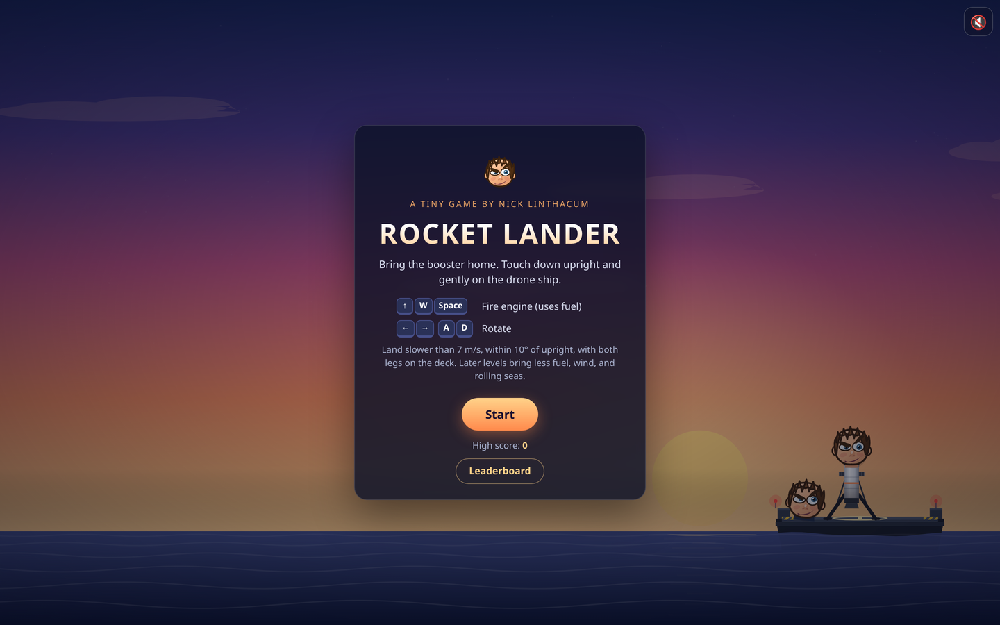
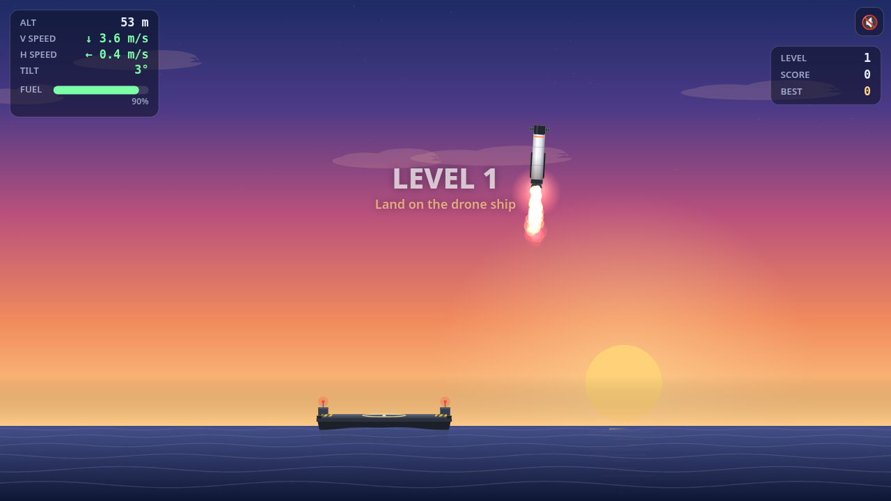

# Rocket Lander

A tiny Lunar Lander-style browser game: bring a reusable rocket booster down onto a drone ship at sea. It's a single self-contained `index.html` (inline CSS and JS, HTML5 Canvas). There are no dependencies and no build step.

**[Play it](https://nlinthacum.github.io/rocket-lander/)**

## Screenshots





## How to play

| Action | Keyboard | Phone / tablet |
|---|---|---|
| Fire main engine (uses fuel) | `↑`, `W`, or `Space` | **THRUST** button |
| Rotate left / right | `←` / `→` or `A` / `D` | ◀ / ▶ buttons |
| Start / next level / retry | `Enter` or `Space` | tap the button |
| Sound on/off (off by default) | `M` | 🔇 button (top right) |

**Landing rules.** Touch down with both legs on the deck, slower than **7.2 m/s** vertically and **4.8 m/s** sideways, and within **10°** of upright. The HUD values turn green when they're inside the limits. Anything else, or missing the ship, ends in an explosion or a splash.

**Score** = accuracy (distance from the deck center, up to 400) + softness (up to 250) + uprightness (up to 100) + fuel left (up to 250). That sum is multiplied by a level bonus (+25% per level). Scores add up across levels until you crash. The best run total is saved in your browser (`localStorage`). Finished runs can also be submitted to the shared leaderboard below.

**Levels get harder:**
- Level 2 adds wind and rolling seas (the ship bobs), with less fuel and a smaller deck.
- Level 3 and beyond add gusty wind and a drifting ship, with even less fuel.

The sky also goes from sunset to dusk to night.

## Global leaderboard

Crash with a score above zero and you can put that run on a shared board. Type a name — 1 to 16 characters, using letters, numbers, spaces, `_`, or `-` — and submit. The panel then shows your rank and the top 10, with your row highlighted when it made the list. The same top 10 is on the start screen, under **Leaderboard**.

While the name box is focused, those keys type instead of flying the rocket. Enter submits. Each run can be submitted once. Your on-device best score is unchanged.

If the leaderboard is offline or slow, the game still plays and the panel says so instead of hanging. Scores are checked again on the server (name rules, a profanity list, score and level limits, and a per-name rate limit).

The page talks to Supabase with `fetch` only — no extra library. The public client key lives in `index.html`. Writes go through the `submit_score` and `top_scores` functions; direct table inserts are rejected.

## Host it on GitHub Pages (free)

The game is live at [https://nlinthacum.github.io/rocket-lander/](https://nlinthacum.github.io/rocket-lander/).

## Embed it in a Notion page

1. Open the Notion page (for example, the one behind nicklinthacum.com).
2. Type `/embed` and choose **Embed**.
3. Paste the hosted URL, `https://nlinthacum.github.io/rocket-lander/`, and click **Embed link**.
4. Drag the block's corner to resize it. A wide block works best, roughly 16:9 or taller.

Tips:
- Click inside the embed once so it receives keyboard input.
- On phones, the on-screen touch buttons appear automatically.
- The high score is stored per browser. Inside a Notion embed it's tied to the github.io origin. The shared leaderboard is the same on every copy of the game.

## Run locally

Just open `index.html` in a browser, or serve the folder:
```bash
python3 -m http.server 8000   # then visit http://localhost:8000
```

## Notes

- `window.RocketLander` is a small test hook (state, start level, step simulation) used by the automated tests. It's harmless to leave in.
- All art is drawn procedurally with Canvas vector shapes. There are no images and no company logos or names.
